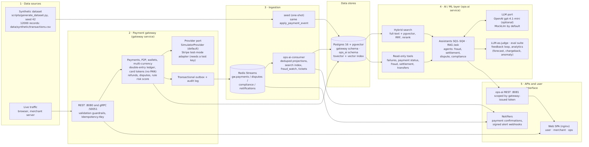

# AI-Powered Payment Gateway Platform (case study)

A payment gateway with an ops assistant. When a payment fails, is declined, looks fraudulent or settles differently than
expected, merchants and operations staff can find the cause with evidence. The LLM only narrates evidence that
deterministic tools computed; without an API key everything runs on a mock LLM.

Status (2026-11-06): the services run end to end as compose services. `make demo` answers all four sample queries
(SQ1–SQ4) over HTTP against a freshly seeded stack. A React web client runs with `make web-up`.



Deployment-level detail (every container, store, stream and port): [docs/architecture.pdf](docs/architecture.pdf).

## Deliverables

| Deliverable | File |
|---|---|
| Architecture diagram (DL1) | Data-flow overview: [docs/architecture-overview.pdf](docs/architecture-overview.pdf) / [.jpg](docs/architecture-overview.jpg); deployment detail: [docs/architecture.pdf](docs/architecture.pdf) / [.png](docs/architecture.png) |
| Design decisions and trade-offs (DL2) | [docs/design.md](docs/design.md) |
| Code + README with E2E examples (DL3) | this README; all four sample queries with input and output: [docs/sample-queries.md](docs/sample-queries.md) |
| 10-minute presentation (DL4) | Slides: [docs/slides.pdf](docs/slides.pdf) ([source](docs/slides.md)); talk script with speaker notes: [docs/presentation.md](docs/presentation.md) |

More: [requirements traceability](docs/requirements-traceability.md) (brief → code → tests),
[production readiness](docs/production-readiness.md) (NFRs, measured vs design only),
[security notes and known gaps](docs/known-gaps.md), [running, testing and configuration](docs/running.md).

## Layout

| Path | What |
|---|---|
| `contracts/` | Versioned event schemas shared by the services (`PaymentEventV1`) |
| `services/gateway/` | FastAPI gateway: sign-up, merchants and API keys, card tokenization, idempotent charges, ledger, outbox, audit log, acquirer simulator |
| `services/ops-ai/` | Stream consumer, payment projection, full-text search, assistant with an LLM port (mock by default) |
| `scripts/generate_dataset.py` | Seeded synthetic dataset (brief fields + extensions) with planted sample-query scenarios |
| `scripts/demo.py`, `scripts/sample_queries.py` | The `make demo` walkthrough with checks, and the raw JSON answers to SQ1–SQ4 |
| `web/` | React web client (user and merchant tabs), served by nginx |
| `tests/` | Cross-service tests: the end-to-end thin slice and import-boundary rules |
| `docs/specs/` | Test specifications that the tests were written from |

## Quick start

Needs Docker with Compose v2 only. All Python tooling (uv, ruff, mypy, pytest, alembic) runs inside the `dev` container.
No `.env` and no `OPENAI_API_KEY` are needed: compose has defaults and the demo secrets are generated into a volume.

```bash
make demo        # build, start every service, seed, run the SQ1–SQ4 walkthrough; exits 0 only if every check passed
make web-up      # web client on http://127.0.0.1:8082 (run after make demo)
make demo-down   # stop everything
make ci          # lint, type, migrations, tests, eval, web checks: what GitHub Actions runs (run make demo-down first)
```

Service list, walkthrough steps, web client, E2E test and settings: [docs/running.md](docs/running.md).

## End-to-end example (SQ1)

Input: merchant `mch_0001` (merchant token from `POST /v1/merchant-tokens`), `POST /v1/assistant/investigate`,
`{"question": "15% of my card payments are failing this afternoon — what is the root cause and how do we fix it?"}`

Output (captured from a fresh stack, trimmed to the fields that carry the answer):

```json
{
  "cause_label": "issuer_outage_on_bin",
  "window":   {"total": 241, "failed": 36, "rate": 0.1494,
               "top_bin": {"card_bin": "400000", "failed": 32, "total": 52},
               "by_code": [{"decline_code": "issuer_unavailable", "count": 32}, {"decline_code": "expired_card", "count": 4}]},
  "baseline": {"total": 390, "failed": 7, "rate": 0.0179},
  "suggested_fixes": ["Rerouted BIN 400000 to acquirer acq_b until the issuer recovered."],
  "tool_calls": ["aggregate_failures", "compare_baseline", "search_incidents"],
  "evidence_refs": ["aggregate:window", "aggregate:baseline", "aggregate:bin:400000", "incident:inc_0001", "payment:…"]
}
```

The failure rate is 14.9% in the window against 1.8% over the 7 days before; 32 of the 36 failures are
`issuer_unavailable` on BIN 400000, and the fix is to reroute that BIN. Every number, label and fix comes from the tools
(`tool_calls`), not from the LLM. SQ2–SQ4 and how to reproduce them: [docs/sample-queries.md](docs/sample-queries.md).

## Synthetic dataset

```bash
docker compose run --rm dev uv run --frozen python scripts/generate_dataset.py --seed 42 --records 12000 --out data/generated
```

Writes `transactions.csv`, `transactions.json` and `incidents.json` (git-ignored). The same seed produces byte-identical files.

The output for seed 42 and 12000 records is committed as [`data/synthetic/transactions.csv`](data/synthetic/transactions.csv)
(12000 rows + header) and [`data/synthetic/incidents.json`](data/synthetic/incidents.json), so the dataset can be read without
running anything. `scripts/__tests__/test_committed_dataset.py` fails if these files drift from the generator. The `seed`
service builds the same records in process from the generator rather than reading the CSV.

- The 16 fields from the brief come first, in the brief's order.
- Extension columns: `record_kind` (merchant payment or P2P transfer), `scenario`, `card_bin`, `acquirer`, `rule_id`,
  `sender_balance`. They exist so that each sample query can be answered from the data alone.
- Planted scenarios: a card failure spike on one BIN this afternoon (SQ1), a cross-border transfer blocked by a KYC limit
  despite sufficient balance (SQ2), a card-testing burst (SQ3), and a merchant whose payout is reduced by refunds,
  chargebacks and FX (SQ4).
- No value looks like a full card number.

## Security in one paragraph

Only allow-listed test card numbers are accepted, and full card numbers are never stored, logged or published (tokens,
BIN, last 4 and a keyed fingerprint only). Passwords use argon2id, MFA is TOTP, API keys are stored as HMAC-SHA256
hashes, and secrets come from the environment (`.env.example`) and never reach logs. Idempotency is enforced by a
database row per (merchant, key). Open gaps are listed in [docs/known-gaps.md](docs/known-gaps.md).
