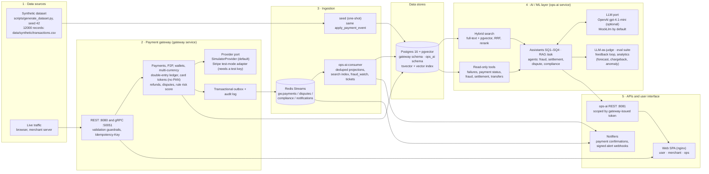

# Architecture overview: data flow (DL1)

The high-level view the brief asks for: how data moves from the synthetic dataset through ingestion, the AI/ML layer
and the APIs to the user-facing interface. Rendered as [architecture-overview.pdf](architecture-overview.pdf) and
[architecture-overview.jpg](architecture-overview.jpg). The deployment-level diagram with every container, store, stream
and port is [architecture.pdf](architecture.pdf) ([source](architecture.md)).

Numbered groups follow the brief's order: data source → ingestion → AI/ML → APIs → interface. The LLM only narrates
evidence that the tools computed; with no API key the stack runs end to end on MockLlm.
