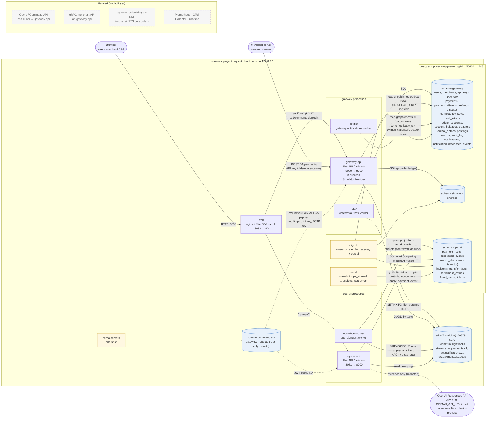
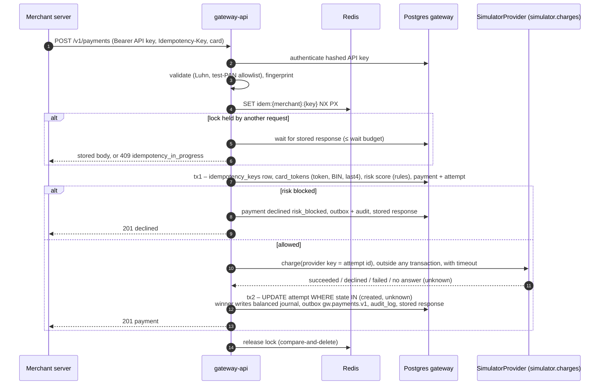
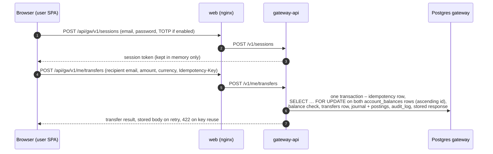
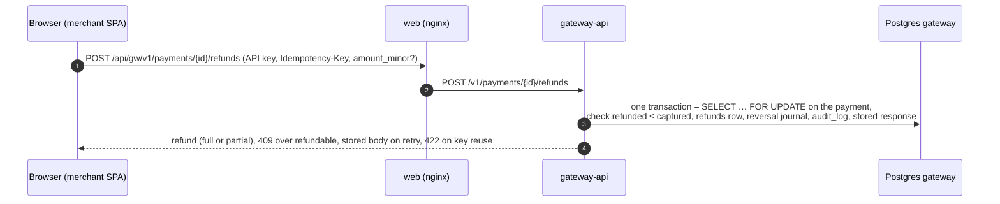
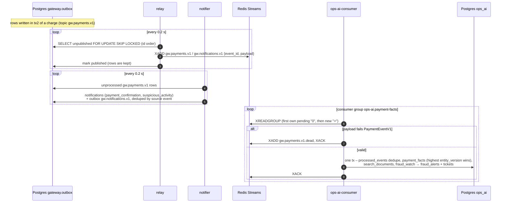
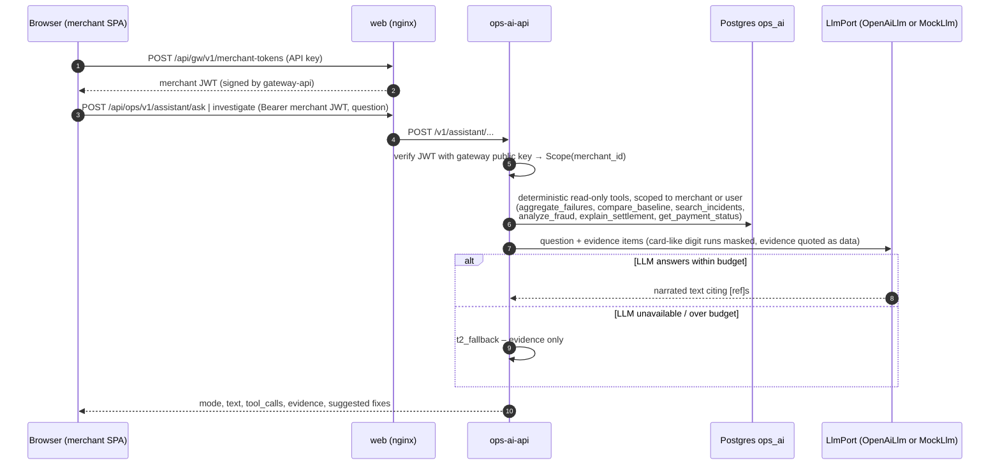

# Architecture

Deliverable DL1. This page shows what runs today in `compose.yaml` and what the code under `services/` does.
The design target is in [`architecture-detail.md`](architecture-detail.md). Anything here that exists only in that
design is drawn with dashed lines and labeled **planned**.

Rendered copies of the runtime topology (§1): [`architecture.png`](architecture.png) and
[`architecture.pdf`](architecture.pdf). Rebuild them with `make docs-diagram`, which runs mmdc in a pinned Docker
image and renders the first Mermaid block on this page.

## 1. Runtime topology (`make demo` / `make web-up`)

**Compose services drawn above**

| Service | Kind | Command / image | Talks to |
|---|---|---|---|
| `postgres` | store | `pgvector/pgvector:pg16` | — |
| `redis` | store | `redis:7.4-alpine` | — |
| `demo-secrets` | one-shot | `scripts/demo_secrets.py` | writes the `demo-secrets` volume |
| `migrate` | one-shot | Alembic, `services/gateway` then `services/ops-ai` | Postgres |
| `seed` | one-shot | `ops_ai.seed`, `ops_ai.transfers`, `ops_ai.settlement` | Postgres (`ops_ai`) |
| `gateway-api` | long-running | `gateway.main:build_app_from_env` | Postgres (`gateway`, `simulator`), Redis |
| `relay` | long-running | `gateway.outbox.worker` | Postgres (`gateway.outbox`), Redis streams |
| `notifier` | long-running | `gateway.notifications.worker` | Postgres (`gateway`) |
| `ops-ai-api` | long-running | `ops_ai.main:build_app_from_env` | Postgres (`ops_ai`), Redis (readiness), optional OpenAI |
| `ops-ai-consumer` | long-running | `ops_ai.ingest.worker` | Redis streams, Postgres (`ops_ai`) |
| `web` | long-running | `web/` build, nginx | `gateway-api`, `ops-ai-api` |

Not drawn: the profile-only helpers `dev` (toolchain), `demo` (runs `scripts/demo.py` against both APIs), `web-dev`
(Node) and `web-smoke` (Playwright). They are not part of the running platform.

**Boundaries the code enforces**

- The two services share no Python code except `contracts/` (event schemas), and each owns its schema.
  ops-ai never reads the `gateway` schema; the only live data path from gateway to ops-ai is the outbox stream.
- ops-ai verifies the JWTs that gateway issues, using the public key from the shared secrets volume. It issues none.
- nginx is the only browser entry. It returns 404 for `POST /api/gw/v1/payments` (raw PAN, server-to-server only),
  `/api/gw/v1/user-tokens`, `/api/gw/v1/disputes*`, `/api/ops/v1/assistant/investigate-transfer` and the API docs.
- `gw.notifications.v1` is published but has no consumer yet. Notifications are read from `gateway.notifications`.

## 2. Card payment (`POST /v1/payments`, sync, no LLM)

- Correctness does not depend on Redis: the unique `idempotency_keys` row in tx1 still yields one charge with Redis down.
- The PAN is never stored. The event carries BIN, last4 and a keyed `card_ref`, no PAN.
- **Planned:** the background reconciler for attempts left in `created`/`unknown` (only the tx2 guard exists today).

## 3. P2P transfer (`POST /v1/me/transfers`)

- Same-currency, internal, synchronous: no hold, no provider call, no outbox event.
- The SQ2 assistant (`/v1/assistant/investigate-transfer`) reads `ops_ai.transfer_facts`, which `seed` loads from the
  synthetic dataset, not from this live path. It needs a user token and nginx does not expose it to the browser.

## 4. Refund (`POST /v1/payments/{id}/refunds`)

- No provider call and no outbox event for refunds today.
- Disputes: `GET /v1/disputes/{id}` and evidence submission exist in gateway-api; nginx keeps them off the browser.

## 5. Events into ops-ai

- Delivery is at least once. A crash between `XADD` and marking published re-sends; the consumer's
  `processed_events` row in the same transaction makes the re-send a no-op.
- Historical data reaches `ops_ai` through `seed`, which runs the same `apply_payment_event` on the synthetic dataset.
  **Planned:** the backfill importer that writes history through the gateway (architecture-detail §2).

## 6. Ops assistant (`/v1/assistant/*`)

- Routes: `ask`, `investigate` (SQ1), `investigate-fraud` (SQ3), `explain-settlement` (SQ4) take a merchant token;
  `investigate-transfer` (SQ2) takes a user token. The SPA calls `ask` and `investigate`.
- The tools decide what data is read. The LLM only narrates the evidence it is given; it has no tools and cannot
  write. With no `OPENAI_API_KEY`, `MockLlm` answers (model `mock`).
- **Planned:** model-driven tool loop and answer-contract checker, Redis session memory, `get_payment_status` through
  the gateway Query API (today it reads `ops_ai.transfer_facts`), routing-override proposals through the Command API (architecture-detail §4–§5).
