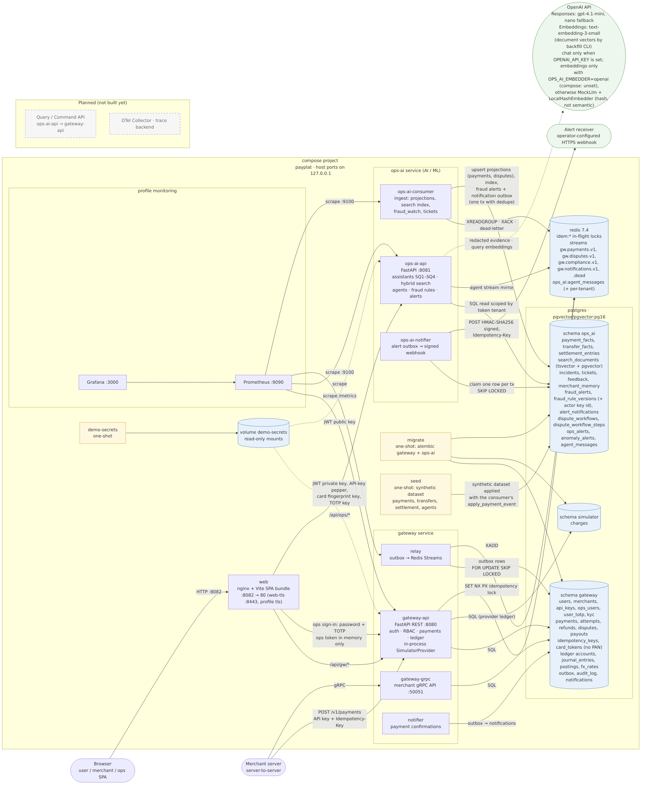

# AI-Powered Payment Gateway Platform — 10 分プレゼン / 10-minute presentation (DL4, draft)

> EN: 12 slides + 2 appendix slides. Each slide has an English title and a 1–2 line English summary of its claim,
> evidence and constraint; the slide body and speaker notes are in Japanese.

本編 12 枚 + Appendix 2 枚。スライドは `---` 区切りで、各スライドの `Note:` 以下が speaker notes。

ラベルの意味（全スライド共通）:

- **Done**: 実装とテストがある（`docs/requirements-traceability.md` の Status が Done）
- **Partial**: 一部だけ実装。欠けている部分はその場で言う
- **Design only**: `docs/design.md` に設計があるだけで、コードも計測もない

時間配分（話す時間は約 7:25、残りは Q&A）:

| 区分 | 時間 |
|---|---|
| 導入 | 0:30 |
| アーキテクチャ・コア決済（`make demo` 含む）・AI | 2:00 |
| SQ1–SQ4 | 2:40 |
| セキュリティ・NFR・本番設計 | 2:00 |
| gap・次の一手 | 0:35 |

デモはライブ実行しない。README の出力（2026-11-05、fresh stack で取得）を見せる。

根拠: `README.md`、`docs/design.md`、`docs/requirements-traceability.md`、`docs/production-readiness.md`、
`docs/architecture.png`、`docs/perf/README.md`。

---

## 1. 課題とスコープ / Problem and scope

> EN: Claim: merchants and ops get cause, evidence and fix for payment problems while the payment path stays correct. Evidence: Basic 13 + SQ1–SQ4 + NFR in the traceability matrix. Constraint: no real money, card network or KYC; simulator and seed data stand in.

**一文の目標**: 決済が失敗した、decline された、不正が疑われる、入金額が想定と違う。こうしたとき merchant と
ops 担当が「原因・証拠・修正案」を得られるようにする。その間も決済経路は正しく動かす。
二重請求は起こさず、ledger は balance させ、カード番号は保存しない。LLM が落ちていても動かす。

- 対象: brief の Basic 13 項目 + SQ1–SQ4 + NFR
- やっていないこと: 実際のお金の移動、実カードネットワーク、実 KYC。これらは simulator と seed データで代替した
- データ: seed 42 の合成データ 12,000 件 + incident 5 件

Note:
0:30。最初に「何を約束していて、何を約束していないか」を言う。お金は動かない。カードネットワークは simulator、
KYC は seed した判定記録。ここで線を引いておけば、後の SQ2 や NFR のスライドで誤解されない。
数字はすべてこのリポジトリの README / traceability / perf から取っている、と一言添える。

---

## 2. アーキテクチャと主要判断 / Architecture and key decisions

> EN: Claim: two services joined only by `contracts/`, with AI outside the write path. Evidence: import rules test, outbox → Redis Streams → idempotent consumer. Constraint: Redis has no ACL (slide 9).

- 2 サービス構成。**gateway** は決済・ledger・認証、**ops-ai** は projection・検索・assistant。共有するのは `contracts/`
  （`PaymentEventV1`）だけで、import 境界は `tests/test_import_rules.py` で強制している
- イベントの流れ: transactional outbox → relay → Redis Streams `gw.payments.v1` → consumer。consumer は
  `processed_events` で重複を捨て、不正形式は dead-letter に送る
- 主要判断: AI は決済の書込経路に入らない。ops-ai は読む側なので、LLM が落ちても charge は通る

Note:
0:45。図は `docs/architecture.png`（PDF 版は `docs/architecture.pdf`）。ポイントは 3 つ。
(1) サービス間の結合は contracts だけ。import の禁止はテストで強制している。
(2) DB の commit と stream publish のずれは outbox で吸収する。consumer は event id で重複を捨てる。
(3) AI は書込経路の外にある。LLM 障害で落ちるのは ops-ai の回答品質だけ。
Redis に ACL がない点は、セキュリティのスライドで正直に言う。

---

## 3. コア決済と `make demo` / Core payments and `make demo`

> EN: Claim: wallet, card charge, multi-currency, idempotency and REST + gRPC are Done; `settlement_currency` survives REST and gRPC round trips. Evidence: ledger, FX and round-trip tests; `make demo` checks. Constraint: one 20-way same-key test failed once under load; chargebacks are not FX-aware; demo gRPC is plaintext on loopback.

| 機能 | 状態 | 要点 |
|---|---|---|
| Wallet / P2P | Done | double-entry ledger、minor units。`FOR UPDATE` は account id 順に取る |
| Merchant card charge | Done | tokenise してから課金する。provider は transaction の外で呼ぶ |
| Multi-currency / FX | Done | FX leg は通貨ごとの clearing account を通る。`settlement_currency` は merchant REST・consumer REST（`/v1/me/payments`）・gRPC `CreatePayment` のどれでも保持され、round trip のテストがある。rate は static seed で、live feed はない |
| Idempotency | Done | 裁定するのは Postgres の unique 行。Redis lock は競合を減らすだけ |
| REST + gRPC | Done | 同じ domain service と同じ validation module を使う。422 は code ごとに gRPC status を分ける（key 再利用・FX 換算後 0 → `INVALID_ARGUMENT`、rate なし → `FAILED_PRECONDITION`、未知 → `INTERNAL`）。demo の gRPC は loopback で平文 |

Idempotency の応答:

| 状況 | 応答 |
|---|---|
| retry | 保存済みの body |
| 同じ key で別 body | 422 `idempotency_key_reused` |
| 処理中 | 5 s 待って 409 |
| 結果が不明 | 202。failed とは言わない |

- 同一 key 20 並列のテスト（P0-1）は、負荷下で 1 回失敗した（20 件中 1 件が 409）。原因は未確定。
  単独実行では 3/3 で通る
- `make demo`: `.env` も key も要らない。seed → live charge 3 件（承認 / decline / 同一 key の retry）→ SQ1–SQ4 を
  check 付きで質問する。全 check が通った時だけ exit 0。手順は Appendix A

Note:
0:35。伝えたいのは idempotency の設計判断。Redis は速くするための仕組みで、正しさは DB の unique 制約が持つ。
だから Redis が落ちても二重課金にはならない。provider は transaction の外で呼び、結果の書込（tx2）は compare-and-set にしている。
結果がわからない時は 202 を返し、勝手に failed にはしない。
並列テストの失敗は隠さない。単独で 3/3 通っても、負荷下の 1 回の失敗は打ち消せない。P0-1 は Partial
（Redis flush と lock 期限切れのケースはまだ run していない）。
ほかの注意点。chargeback はまだ FX に対応していない（B2.3）。gRPC の TLS は実装済みだが、compose demo では
`GATEWAY_GRPC_INSECURE=true` で動かしている。

---

## 4. AI 機能と「何が実証されているか」 / AI features and what is proven

> EN: Claim: tools produce every number, label and fix; the LLM only narrates. Evidence: deterministic eval gate in CI, fraud 40/40 with 2.5 % FP on synthetic data. Constraint: the keyless demo uses MockLlm, the default embedder is spelling-level (not semantic), LLM-judged metrics are skipped.

- **Tools-first**: 数字・ラベル・修正案は tool が出す。LLM は evidence を文章にするだけで、narration には tool を渡さない
- NL failure query（B4）と RAG（B5）。hybrid search（B6）は FTS と pgvector を RRF（k=60）で融合する。ただし既定の embedder
  `LocalHashEmbedder` は hash ベースの spelling-level で、**semantic search ではない**。semantic にするには
  `OPS_AI_EMBEDDER=openai` と key が要り、compose では未設定
- Fraud（B7）: card-testing を検知する。合成データでは 40/40 の burst を検知し、FP は 2.5 %（正常 160 グループ中 4）
- Tool calling（B9）: `/v1/assistant/query` は 1 回の planning call（最大 4 tool）で、agent loop ではない
- Multi-agent（R2-1）と LLM-as-judge（R2-2）は **Partial**
- Eval: `make eval` の deterministic gate は CI に入っている。LLM-judged metric は key がないので **skipped**（P0-15 Partial）

**実証範囲**: key なしの demo では MockLlm が文章を書く。示しているのは「tool の実行と応答の経路」までで、
自然言語の品質は示していない

Note:
0:40。一番過大主張しやすいところなので、先に線を引く。demo の回答は `"model": "mock"`。
ラベルや数字は tool が決めているので、key を入れて変わるのは narrated text だけ。
本物の LLM は gpt-4.1-mini-2025-04-14 で、fallback が nano。両方落ちたら T2 に倒れ、evidence だけを返す。
OpenAI adapter のテストは fake HTTP server 相手で、実接続はテストしていない。
既定の embedder `LocalHashEmbedder` は spelling-level で、semantic ではない。
fraud の FP 2.5 % は合成のラベル付きデータでの値で、本番データではない。検知率 40/40 と必ずセットで言う。

---

## 5. SQ1: 午後に card の失敗が 15 % — 原因と修正 / SQ1: 15 % afternoon card failures, cause and fix

> EN: Claim: the cause is an issuer outage on BIN 400000; the fix is to reroute to `acq_b`. Evidence: 14.9 % vs a 1.8 % baseline, 32 of 36 failures on that BIN, past incident `inc_0001`. Constraint: the `/failures` route does not find the incident in the seed; only `/investigate` cites it.

`POST /v1/assistant/investigate`（merchant `mch_0001`）

- 観測: 窓は 241 件中 36 件失敗で **14.9 %**。7 日 baseline は 390 件中 7 件で **1.8 %**（8.3 倍）。
  失敗 36 件のうち 32 件が BIN `400000` の `issuer_unavailable`
- 答え: `issuer_outage_on_bin`。修正案は「BIN 400000 を復旧まで acquirer `acq_b` に reroute」（過去 incident `inc_0001` を引用）。
  demo の live decline も evidence に入る
- 限界: `/failures` route は incident を FTS で探すため、seed ではヒットしない。incident の引用は `/investigate` 側だけ

Note:
0:40。数字はすべて tool の集計で、LLM は書いていない。tool の順序は `aggregate_failures` → `compare_baseline` →
`search_incidents`。`/v1/assistant/failures` は fact / hypothesis / 確認方法を分けて出し、playbook から修正案を
順位付けする。eval は両 route にある（`sq1_bin_outage` と `sq1_failure_route`）。

---

## 6. SQ2: 残高は足りていたのに国際送金が decline — どの rule か / SQ2: cross-border transfer declined despite the balance

> EN: Claim: the KYC tier 1 cross-border limit (1,000.00 USD per transfer) fired, not insufficient funds. Evidence: a 1,800.00 USD transfer against a 5,250.00 USD balance; role checks return 403. Constraint: the transfer is a seeded decision record, not one the gateway executed.

`POST /v1/assistant/investigate-transfer`（seed の送金者、user token、role `consumer`）

- 観測: 送金 1,800.00 USD（US → IN）、残高 5,250.00 USD。**残高不足ではない**
- 答え: 発火したのは KYC tier 1 の cross-border 上限 1,000.00 USD / 回（`cross_border_limit_for_kyc_tier`、対応者は
  `sender`）。修正案は KYC tier 2 への引き上げ（上限 10,000.00 USD / 回）
- 限界: この送金は seed した判定記録で、gateway が実行した送金ではない

Note:
0:40。platform は「調べる」側で、送金の実行や KYC 判定はしていない。記録は `scripts/transfer_fixture.py` が作る。
tool は `get_payment_status` 1 つで、本人の送金だけを読む。
権限の check もある。merchant token はこの route で 403、user token は `/investigate` で 403。

---

## 7. SQ3: 少額の card payment が連続 — card testing か / SQ3: micro-payment series, card testing?

> EN: Claim: both the live and the seeded bursts are flagged as card testing, each with an alert, an outbound notification and a `fraud` ticket (SQ3 Done). Evidence: pattern features per episode, notifier outbox tests, E2E golden `sq3_card_testing`. Constraint: the demo wires no notification receiver (log sink); failed notifications are not replayed.

`POST /v1/assistant/investigate-fraud`（merchant `mch_0002`）

| episode | 少額決済 | カード数 | decline 率 | 判定 |
|---|---|---|---|---|
| demo の live burst | 12 | 4 | 0.5 | flagged（`micro_burst`, `many_cards`, `high_decline_ratio`） |
| seed の burst | 40 | 不明 | 1.0 | flagged（`micro_burst`, `card_identity_unknown`, `high_decline_ratio`） |

- 答え: `card_testing`。episode ごとに alert 1 件と `fraud` queue の ticket（priority `high`）が立つ。alert ごとに通知 1 件を
  watcher の transaction で outbox に積み、`ops-ai-notifier`（`make demo` で起動）が配送する。
  修正案は 3 つ: 1.00 以下の velocity limit、3-D Secure の必須化、burst のカードには触らない
- 状態: **Done**（traceability の SQ3 行。README の SQ3 節も Done に揃えた）
- 限界: demo には通知の受け手がない（log sink のみで、`ops-ai-notifier` の log に出るだけ）。signed webhook に送るのは
  `OPS_AI_ALERT_WEBHOOK_URL` を設定した時だけ

Note:
0:40。検知は consumer が projection と同じ transaction で走らせる。episode は 120 s の gap で区切る。
flag 条件は、少額 10 件以上・少額比率 80 % 以上・カード 3 枚以上（またはカード不明）。
カードの識別は `card_ref` で、merchant 単位の HMAC。だから merchant をまたいでカードを紐付けることはない。
失敗した通知（5 回試行）は replay されない。

---

## 8. SQ4: 入金が想定より少ない理由 / SQ4: why the payout is lower than expected

> EN: Claim: the 1,086.26 USD gap is explained line by line and the lines sum to net. Evidence: 8 lines reconciled against 202 projected payments (`verified: true`). Constraint: settlement lines are a seeded acquirer report; the gateway's own settlement batch and payout are design only.

`POST /v1/assistant/explain-settlement`（merchant `mch_0003`、2026-10、USD）

| 行 | 金額 (USD) | 件数 |
|---|---|---|
| gross | 11,251.37 | 202 |
| MDR (2.90 %) | −326.29 | 202 |
| fixed fees | −60.60 | 202 |
| FX | −8.76 | 10 |
| refunds | −283.93 | 8 |
| chargebacks | −125.40 | 3 |
| chargeback fees | −45.00 | 3 |
| reserve (5 %) | −562.57 | 202 |
| **net** | **9,838.82** | |

- 答え: 想定の 10,925.08 USD との差 1,086.26 USD を行ごとに説明する。文章を書く前に projection の 202 件と照合している（`verified: true`）
- 限界: settlement の明細は acquirer report として seed したもの。gateway 自身の settlement batch と payout は Design

Note:
0:40。demo は、8 行の合計が net になることと、summary を書く前に projection と照合していることを check している。
reserve は保留分で、後の payout で返ってくる。

---

## 9. セキュリティ: 実装済みと未実装を並べる / Security: done and not done side by side

> EN: Claim: card data, passwords, TOTP secrets, API keys and secrets are protected as listed. Evidence: tokenisation, argon2id, AES-256-GCM, HMAC hashes, RS256 checks. Constraint: no Redis ACL, superuser DB login, TLS only on browser → nginx, no login rate limit or token revocation.

| 実装済み (Done) | まだない |
|---|---|
| Card tokenisation: 保存するのは token・BIN・last4・HMAC fingerprint だけ。PAN は保存も log も publish もしない | Redis に ACL がない。Redis に届く人は偽の payment event を流せる |
| Password は argon2id。同時 verify は 4 本までで、2 s 待つと 503 | Postgres には superuser でログインし、`SET ROLE` するだけ（`RESET ROLE` で戻れる） |
| TOTP secret は AES-256-GCM で封印し、user id を AAD にする | login の per-IP rate limit がない。signup の 409 で email の存在が漏れる |
| API key は HMAC-SHA256 の hash で保存。token は RS256 で iss/aud/exp を検査する | merchant token の失効と鍵 rotation（`kid`）がない |
| Secrets は `SecretStr` で扱う。各サービスは必要な secret だけを read-only で mount する | TLS は browser → nginx だけ（`make tls-up`、dev 証明書）。nginx → web、web → API、Postgres、Redis は compose network 上で平文。service mTLS は Design only |

Note:
0:30。左だけ見せると強く見えすぎるので、右を同じ画面に出す。一番大きいのは Redis ACL と DB role。
consumer は payment を別の merchant に移すことは拒否する。ただ、存在しない payment を記録することはできてしまう。
修正は、サービスごとの Redis ACL user と、schema grant 付きの DB role。
TLS も「入れた」とだけ言わない。暗号化しているのは browser → nginx の区間だけ（NFR-SEC transport は Partial）。
audit log の append-only は trigger と grant で実装済み。ただ superuser でログインしたままなので、P0-10 は Partial。

---

## 10. NFR: 計測した数字と、計測していないもの / NFR: what was measured and what was not

> EN: Claim: the p99 < 2 s target is not met. Evidence: k6 at 2 req/s gives p99 2.82 s; at 40 req/s it saturates near 7 req/s; 0 % errors (`docs/perf/README.md`). Constraint: a shared laptop VM and 3 hot cards; 100k TPS, 99.999 % and multi-region are design only.

k6 で `POST /v1/payments`（card）を計測した。目標は p99 < 2 s かつ error < 1 %（`docs/perf/README.md`）。

| 投入負荷 | 実測の処理量・完了数 | p50 | p95 | p99 | error | 目標 |
|---|---|---|---|---|---|---|
| 2 req/s | 181 件、drop なし | 405 ms | 1.91 s | **2.82 s** | 0 % | **未達** |
| 40 req/s | 約 7 req/s で飽和。745 件、2,856 iteration を drop | 24.9 s | 41.4 s | 44.5 s | 0 % | **未達** |

- 環境: 共有の laptop VM で、他の compose stack と同居。負荷は 3 枚の test カードに集中し、カードごとに lock がかかる
- **Design only**（コードも計測もない）: 100k TPS / 1 億 user（P2-7）、99.999 %（P2-2）、multi-region（P2-1）

Note:
0:45。目標は満たしていない、と最初に言う。error は 0 % で、5xx もない。遅さの主因は、3 枚のカードにかかる
per-card lock の待ち行列。40 req/s を投入しても実際に捌けたのは約 7 req/s で、待ちは数十秒まで伸びた。
つまりこれは hot card の競合試験で、本番構成（多数のカード、gateway の水平 replica）を測ったものではない。
切り分けには 2 つ要る。(1) 専用マシン、(2) 多数の tokenised card を混ぜた負荷。
今は allowlist の test PAN が 5 つしかないので、(2) ができない。
100k TPS・99.999 %・multi-region は数字を出していない。設計だけ。

---

## 11. 本番設計と crash recovery（Design only を含む） / Production design and crash recovery

> EN: Claim: a design for 99.999 % on the write path, the DB choice, 100k TPS partitioning and a reconciler. Evidence: crash cases C2–C4 by in-process fault injection. Constraint: C1, C5, the reconciler and real process kills are design only.

- 99.999 %（P2-2）の対象は **payment write path** だけ。error budget は 25.9 s/月なので、秒単位の failover が要る
- DB の選択（P2-1）: Spanner multi-region と、per-region Cloud SQL + reconciliation を比較した。money table は Spanner 案
- 100k TPS（P2-7）: 1 charge ≈ 10 row write という**見積もり**から、約 1M row write/s。単一の Postgres では足りないので、
  account / merchant id で partition する
- Crash matrix: C2–C4 は **in-process の故障注入テストで確認した範囲**。C1（provider 成功後に gateway が落ちる）と
  C5（結果不明のまま保持期間を超える）は **Design only**。実 process kill のテストもない
- Reconciler は**設計案**: provider 成功後にローカルの記録が欠けた状態を見つけ、収束させる。
  前提は 3 つ: 照合 key が安定していること、provider 側で結果を照会できること、再実行が冪等であること。
  未実装なので、回復の保証としては扱わない

Note:
0:45。perf の未達と crash recovery の穴は別の問題で、手当ても別。
reconciler の設計案では、provider が attempt id をキーに自分の ledger を持っている前提で `provider.lookup` を使い、
`unknown` や `created` のまま止まった attempt を収束させる。今は C1 になると、その key は 409 を返し続ける。
再計測で切り分けたいのは、遅いのが環境のせいか設計のせいか。どちらも未着手なので、ここは設計として話す。
PR-1（同一 key 20 並列で provider 呼び出しが 1 回になるテスト、約 40 s）は、Q&A で求められたら実演する。

---

## 12. 既知の gap・次の一手・まとめ / Known gaps, next steps and summary

> EN: Claim: SQ1–SQ4 run end to end with checks, and the correctness core is pinned by tests. Evidence: traceability rows and `make demo`. Constraint: one known concurrent test failure, the perf target is missed, production scale is unmeasured; the reconciler comes first.

**主な Partial**（全体は Appendix B）

- 決済の正しさ: P0-1（Redis flush / lock 期限切れの run がない）、P0-4（reconciler も実 kill もない）
- AI: R2-1 multi-agent、R2-2 LLM-as-judge、P0-15（LLM-judged eval を未実行）、P1-8（prompt hash と token 予算がない）
- 運用: P0-13 metrics、P0-14 alert、P1-2 retry + backoff、P1-5 load test。PR-2（alert → runbook の demo）は未収録

**次の一手（この順で）**

1. Reconciler を作る（C1/C5 の収束、`unknown` の解消）
2. 専用環境で、多数のカードを使って再計測する
3. Redis ACL とサービスごとの DB role を入れる
4. key を入れ、LLM-judged eval を CI で回す

**まとめ**: SQ1–SQ4 は tool が根拠を出し、check 付きで end to end に動く。正しさの核（idempotency・ledger）は
テストで固定した。ただし既知の並列テスト失敗が 1 件ある。性能目標と本番規模は未達・未計測で、そのように表示している。

Note:
0:35。順番の理由。reconciler は正しさの穴なので、性能より先にやる。再計測は、設計判断の前提を確かめるため。
Redis ACL と DB role は、セキュリティで一番大きい残差。LLM-judged eval は key が来れば回せる。
最後にもう一度「動くものと設計だけのものを分けて書いた」と言って終わる。残りは Q&A。

---

## Appendix A: `make demo` の 9 ステップ（`scripts/demo.py`） / The 9 steps of `make demo`

> EN: Claim: `make demo` checks each SQ answer and exits 0 only if all checks pass. Evidence: `scripts/demo.py`. Constraint: passwords and tokens are not printed; API keys show only the first 8 characters.

1. seed の SQ1 merchant `mch_0001` の API key を取り、`demo+<random>@example.com` で sign-up する
2. HTTP で charge を 3 件送る: 承認 1 件、SQ1 BIN（`4000000000000119`、issuer unavailable）での decline 1 件、
   承認分と同じ `Idempotency-Key` での retry 1 件（同一 body を check）
3. API key を merchant token に交換する（RS256 JWT、issuer `gateway`、audience `ops-ai`、有効期間 15 分）
4. 両方の payment が stream に載り、consumer group が lag 0・pending 0 になるまで待つ
5. "declined payments" と質問し、evidence が decline 側だけを引くことを check する
6. SQ1（`/v1/assistant/investigate`）: label `issuer_outage_on_bin`、top BIN `400000`、窓 10–20 % 対 baseline 5 % 未満、
   `inc_0001`、live decline の引用を check する
7. SQ2（`/v1/assistant/investigate-transfer`）: seed の送金者に新しい password を設定してログインし、
   `cross_border_limit_for_kyc_tier` と 403 を check する
8. SQ3（`/v1/assistant/investigate-fraud`）: `mch_0002` で 0.50 USD × 12 件の live burst（4 カード、6 件 decline）を送り、
   `card_testing`、alert、`fraud` ticket の引用を check する
9. SQ4（`/v1/assistant/explain-settlement`）: `mch_0003` で、8 行の順序と合計、net < 想定、403 を check する

API key は先頭 8 文字だけ表示する。password と token は表示しない。

Note:
本編では使わない。Q&A で「demo は何を check しているのか」と聞かれたら開く。

---

## Appendix B: traceability の Partial 行 / Partial rows in the traceability matrix

> EN: Claim: every Partial row with what it lacks. Evidence: the Status column of `docs/requirements-traceability.md`. Constraint: the wording here is shortened; the matrix is the source of truth.

| 区分 | 行 | 欠けているもの（traceability の Status から） |
|---|---|---|
| 決済の正しさ | P0-1 | Redis flush / lock 期限切れでの run がない |
| | P0-2 | ledger の property test は広いが、行の状態は Partial |
| | P0-4 | reconciler、実 process kill、`tests/e2e/crash/` がない |
| | P1-1 | crash coverage が P0-4 に依存している |
| | P1-2 | retry + backoff + jitter と、N 回失敗の rule がない |
| AI | P0-5 | T2 は実証済み。`LlmPort` 障害時の charge・risk flag・card-testing alert のテストがない |
| | P0-6 | card 番号の mask は済み。email / phone / password / token の全 field canary がない |
| | P0-7 | `suggestion_id` flow と、human JWT での refund がない |
| | P0-8 | resolution notes の injection fixture と、schema 不正出力の拒否テストがない |
| | P0-15 | LLM-judged metric が skipped |
| | P1-8 | model id の env での日付 pin、prompt hash、token 予算がない |
| | R2-1 / R2-2 / R2-6 / R2-7 | multi-agent、judge、agent 間 message、feedback loop は一部のみ |
| | R2-8 / R2-10 | 予測 analytics（合成データ）と AML/KYC/GDPR は一部のみ |
| Security | P0-9 | 後から足した route が既存の action を流用している |
| | P0-10 | superuser でログインしている。hash chain がない |
| | P0-11 | 全サービスの container log での canary 確認がない |
| 運用 | P0-12 | tool span と exporter がない |
| | P0-13 | LLM cost と eval score の metric がない |
| | P0-14 | reconciler-unknown の rule と外部 paging がない |
| | P1-5 | 本番相当の負荷計測がない |
| | P1-6 | graceful shutdown は一部のみ |
| UI / demo | B13.3 | ops console は一部のみ |
| | PR-2 | alert → dashboard → runbook の demo が未収録 |
| NFR | NFR-SCALE / NFR-AVAIL / NFR-GEO | Design only |

Note:
本編では使わない。「他に何が足りないか」と聞かれたら開く。各行の正確な文言は
`docs/requirements-traceability.md` にある。
