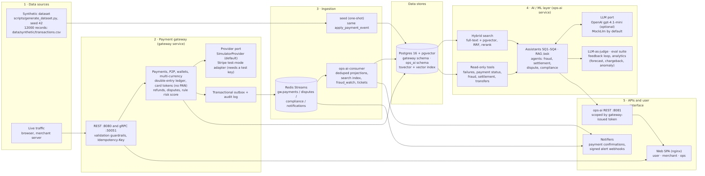

<!-- _class: lead -->
<!-- _paginate: false -->

# AI-Powered Payment Gateway Platform

Case study · DL4 · 10-minute presentation (≈ 7:25 spoken + Q&A)

**Labels used on every slide**

- **Done**: code and a passing test (Status "Done" in `docs/requirements-traceability.md`)
- **Partial**: only part is built; the missing part is named on the slide
- **Design only**: described in `docs/design.md`; no code and no measurement

Every number comes from `README.md`, `docs/sample-queries.md`, `docs/requirements-traceability.md` or `docs/perf/README.md`.

<!--
ラベルの意味（全スライド共通）:
- Done: 実装とテストがある（docs/requirements-traceability.md の Status が Done）
- Partial: 一部だけ実装。欠けている部分はその場で言う
- Design only: docs/design.md に設計があるだけで、コードも計測もない

時間配分（話す時間は約 7:25、残りは Q&A）:
導入 0:30 / アーキテクチャ・コア決済（make demo 含む）・AI 2:00 / SQ1–SQ4 2:40 / セキュリティ・NFR・本番設計 2:00 / gap・次の一手 0:35

根拠: README.md、docs/design.md、docs/requirements-traceability.md、docs/production-readiness.md、docs/architecture.png、docs/perf/README.md。
ライブで見せる手順と、stack が落ちた時の fallback は Appendix C（Live demo run-sheet）。
-->

---

# 1. Problem and scope

**Goal**: when a payment fails, is declined, looks fraudulent, or a payout is lower than expected, merchants and ops staff get the **cause, the evidence and a fix**, while the payment path stays correct.

- Correctness bar: no double charge, the ledger balances, card numbers are never stored, it keeps working with the LLM down
- Scope: the brief's **Basic 13** items + **SQ1–SQ4** + **NFR**
- Not done: real money movement, real card network, real KYC; a **simulator and seed data** stand in
- Data: synthetic, **seed 42**, **12,000 records + 5 incidents**

<!--
0:30。最初に「何を約束していて、何を約束していないか」を言う。お金は動かない。カードネットワークは simulator、
KYC は seed した判定記録。ここで線を引いておけば、後の SQ2 や NFR のスライドで誤解されない。
数字はすべてこのリポジトリの README / traceability / perf から取っている、と一言添える。
-->

---

<!-- _class: dense -->

# 2. Architecture and key decisions

- **Two services**: `gateway` (payments, ledger, auth) and `ops-ai` (projection, search, assistant)
- They share **only `contracts/`** (`PaymentEventV1`); import boundary enforced by `tests/test_import_rules.py`
- Events: transactional **outbox → relay → Redis Streams** `gw.payments.v1` → consumer; duplicates dropped via `processed_events`, malformed → dead-letter
- **Key decision**: AI stays **out of the payment write path**; if the LLM is down, charges still go through
- Known gap: Redis has **no ACL** (slide 9)

Data flow: `docs/architecture-overview.pdf`; deployment detail: `docs/architecture.pdf` (zoomed: Appendix D)

<!--
0:45。図は docs/architecture.png（PDF 版は docs/architecture.pdf）。ポイントは 3 つ。
(1) サービス間の結合は contracts だけ。import の禁止はテストで強制している。
(2) DB の commit と stream publish のずれは outbox で吸収する。consumer は event id で重複を捨てる。
(3) AI は書込経路の外にある。LLM 障害で落ちるのは ops-ai の回答品質だけ。
Redis に ACL がない点は、セキュリティのスライドで正直に言う。
-->

---

<!-- _class: dense -->

# 3. Core payments and `make demo`

| Feature | Status | Key point |
|---|---|---|
| Wallet / P2P | **Done** | Double-entry ledger, minor units; `FOR UPDATE` taken in account-id order |
| Merchant card charge | **Done** | Tokenise first, then charge; the provider is called outside the DB transaction |
| Multi-currency / FX | **Done** | FX legs via per-currency clearing accounts; `settlement_currency` kept on merchant REST, consumer REST (`/v1/me/payments`) and gRPC `CreatePayment`, with round-trip tests. Static seed rates, no live feed; chargebacks not yet FX-aware |
| Idempotency | **Done** | A Postgres unique row decides; the Redis lock only reduces contention |
| REST + gRPC | **Done** | Same domain service, same validation module; 422 → gRPC status per code (reused key / zero after FX → `INVALID_ARGUMENT`, no rate → `FAILED_PRECONDITION`, other → `INTERNAL`); demo gRPC is plaintext on loopback |

- Idempotency answers: retry → stored body · same key, other body → 422 `idempotency_key_reused` · in flight → 409 after 5 s · outcome unknown → **202, never "failed"**
- **Known failure**: the 20-way same-key test (P0-1) failed once under load (1 of 20 got 409); cause not identified; passes 3/3 when run alone
- `make demo`: no `.env`, no key. Seed → 3 live charges (approved / declined / same-key retry) → SQ1–SQ4 with checks; **exit 0 only if every check passes** (Appendix A)

<!--
0:35。伝えたいのは idempotency の設計判断。Redis は速くするための仕組みで、正しさは DB の unique 制約が持つ。
だから Redis が落ちても二重課金にはならない。provider は transaction の外で呼び、結果の書込（tx2）は compare-and-set にしている。
結果がわからない時は 202 を返し、勝手に failed にはしない。
並列テストの失敗は隠さない。単独で 3/3 通っても、負荷下の 1 回の失敗は打ち消せない。P0-1 は Partial
（Redis flush と lock 期限切れのケースはまだ run していない）。
ほかの注意点。chargeback はまだ FX に対応していない（B2.3）。gRPC の TLS は実装済みだが、compose demo では
GATEWAY_GRPC_INSECURE=true で動かしている。
-->

---

# 4. AI features and what is proven

- **Tools-first**: tools produce every number, label and fix; the LLM only turns evidence into text and gets no tools while narrating
- NL failure query (B4) and RAG (B5); hybrid search (B6) fuses FTS + pgvector with RRF (k=60). The default embedder `LocalHashEmbedder` is hash-based, spelling-level: **not semantic search** (needs `OPS_AI_EMBEDDER=openai` + a key; unset in compose)
- Fraud (B7): card-testing detection; on synthetic data **40/40 bursts detected, FP 2.5 %** (4 of 160 legitimate groups)
- Tool calling (B9): `/v1/assistant/query` is **one planning call (≤ 4 tools)**, not an agent loop
- Multi-agent (R2-1) and LLM-as-judge (R2-2): **Partial** · `make eval` deterministic gate runs in CI; LLM-judged metrics **skipped** without a key (P0-15 **Partial**)
- **What is proven**: the keyless demo uses **MockLlm**. It shows the tool execution and response path, **not natural-language quality**

<!--
0:40。一番過大主張しやすいところなので、先に線を引く。demo の回答は "model": "mock"。
ラベルや数字は tool が決めているので、key を入れて変わるのは narrated text だけ。
本物の LLM は gpt-4.1-mini-2025-04-14 で、fallback が nano。両方落ちたら T2 に倒れ、evidence だけを返す。
OpenAI adapter のテストは fake HTTP server 相手で、実接続はテストしていない。
既定の embedder LocalHashEmbedder は spelling-level で、semantic ではない。
fraud の FP 2.5 % は合成のラベル付きデータでの値で、本番データではない。検知率 40/40 と必ずセットで言う。
-->

---

# 5. SQ1: 15 % afternoon card failures, cause and fix

`POST /v1/assistant/investigate` · merchant `mch_0001` · traceability: SQ1 **Done**

- Observed: window **36 of 241 failed = 14.9 %**; 7-day baseline **7 of 390 = 1.8 %** (8.3×)
- **32 of the 36** failures are `issuer_unavailable` on BIN `400000`
- Answer: `issuer_outage_on_bin`. Fix: **reroute BIN 400000 to acquirer `acq_b`** until the issuer recovers (cites past incident `inc_0001`)
- The demo's live declined charge is part of the evidence
- Limit: the `/failures` route searches incidents by FTS and finds none on the seed; **only `/investigate` cites the incident**

<!--
0:40。数字はすべて tool の集計で、LLM は書いていない。tool の順序は aggregate_failures → compare_baseline →
search_incidents。/v1/assistant/failures は fact / hypothesis / 確認方法を分けて出し、playbook から修正案を
順位付けする。eval は両 route にある（sq1_bin_outage と sq1_failure_route）。
-->

---

# 6. SQ2: cross-border transfer declined despite the balance

`POST /v1/assistant/investigate-transfer` · seeded sender, user token, role `consumer` · traceability: SQ2 **Done**

- Observed: transfer **1,800.00 USD** (US → IN), balance **5,250.00 USD**: **not insufficient funds**
- Rule that fired: **KYC tier 1 cross-border limit, 1,000.00 USD per transfer** (`cross_border_limit_for_kyc_tier`, owner `sender`)
- Fix: upgrade to KYC tier 2 (limit 10,000.00 USD per transfer)
- Role checks: merchant token → **403** on this route; user token → **403** on `/investigate`
- Limit: the transfer is a **seeded decision record**, not one the gateway executed

<!--
0:40。platform は「調べる」側で、送金の実行や KYC 判定はしていない。記録は scripts/transfer_fixture.py が作る。
tool は get_payment_status 1 つで、本人の送金だけを読む。
権限の check もある。merchant token はこの route で 403、user token は /investigate で 403。
-->

---

<!-- _class: dense -->

# 7. SQ3: micro-payment series, card testing?

`POST /v1/assistant/investigate-fraud` · merchant `mch_0002` · traceability: SQ3 **Done**

| Episode | Micro payments | Cards | Decline ratio | Result |
|---|---|---|---|---|
| Demo live burst | 12 | 4 | 0.5 | flagged (`micro_burst`, `many_cards`, `high_decline_ratio`) |
| Seeded burst | 40 | unknown | 1.0 | flagged (`micro_burst`, `card_identity_unknown`, `high_decline_ratio`) |

- Answer: `card_testing`. Each episode raises **1 alert + 1 ticket** in the `fraud` queue (priority `high`)
- Each alert queues **1 outbound notification** in the watcher's transaction (outbox); `ops-ai-notifier` (started by `make demo`) delivers it
- Fixes: velocity limit for payments ≤ 1.00 · require 3-D Secure · do not touch the cards in the burst
- Limit: the demo wires **no notification receiver** (log sink: only a line in the `ops-ai-notifier` log); a signed webhook only when `OPS_AI_ALERT_WEBHOOK_URL` is set

<!--
0:40。検知は consumer が projection と同じ transaction で走らせる。episode は 120 s の gap で区切る。
flag 条件は、少額 10 件以上・少額比率 80 % 以上・カード 3 枚以上（またはカード不明）。
カードの識別は card_ref で、merchant 単位の HMAC。だから merchant をまたいでカードを紐付けることはない。
失敗した通知（5 回試行）は replay されない。
-->

---

<!-- _class: dense -->

# 8. SQ4: why the payout is lower than expected

`POST /v1/assistant/explain-settlement` · merchant `mch_0003` · 2026-10 · USD · traceability: SQ4 **Done**

| Line | Amount (USD) | Payments |
|---|---:|---:|
| gross | 11,251.37 | 202 |
| MDR (2.90 %) | −326.29 | 202 |
| fixed fees | −60.60 | 202 |
| FX | −8.76 | 10 |
| refunds | −283.93 | 8 |
| chargebacks | −125.40 | 3 |
| chargeback fees | −45.00 | 3 |
| reserve (5 %) | −562.57 | 202 |
| **net** | **9,838.82** | |

- Answer: the **1,086.26 USD** gap to the expected 10,925.08 USD, line by line; checked against **202 projected payments before any text is written** (`verified: true`)
- Limit: settlement lines are a **seeded acquirer report**; the gateway's own settlement batch and payout are **Design only**

<!--
0:40。demo は、8 行の合計が net になることと、summary を書く前に projection と照合していることを check している。
reserve は保留分で、後の payout で返ってくる。
-->

---

<!-- _class: dense -->

# 9. Security: done and not done, side by side

| Done | Not yet |
|---|---|
| Card tokenisation: only token, BIN, last4 and an HMAC fingerprint are stored; the PAN is never stored, logged or published | **No Redis ACL**: anyone who reaches Redis can push fake payment events |
| Passwords: argon2id; at most 4 concurrent verifies, 503 after a 2 s wait | Postgres: **superuser login** + `SET ROLE` (can `RESET ROLE`) |
| TOTP secret sealed with AES-256-GCM, user id as AAD | No per-IP login rate limit; signup 409 reveals whether an email exists |
| API keys stored as HMAC-SHA256 hashes; tokens RS256 with iss / aud / exp checks | No merchant-token revocation, no key rotation (`kid`) |
| Secrets as `SecretStr`; each service mounts only its own secrets, read-only | **TLS only browser → nginx** (`make tls-up`, dev cert); nginx → web, web → API, Postgres, Redis plaintext on the compose network; service mTLS **Design only** |

- NFR-SEC transport: **Partial** · append-only audit log (trigger + grants) built, but P0-10 **Partial** because of the superuser login

<!--
0:30。左だけ見せると強く見えすぎるので、右を同じ画面に出す。一番大きいのは Redis ACL と DB role。
consumer は payment を別の merchant に移すことは拒否する。ただ、存在しない payment を記録することはできてしまう。
修正は、サービスごとの Redis ACL user と、schema grant 付きの DB role。
TLS も「入れた」とだけ言わない。暗号化しているのは browser → nginx の区間だけ（NFR-SEC transport は Partial）。
audit log の append-only は trigger と grant で実装済み。ただ superuser でログインしたままなので、P0-10 は Partial。
-->

---

<!-- _class: dense -->

# 10. NFR: what was measured and what was not

k6 on `POST /v1/payments` (card). Target: **p99 < 2 s and error < 1 %** (`docs/perf/README.md`)

| Offered load | Measured throughput / completed | p50 | p95 | p99 | Errors | Target |
|---|---|---:|---:|---:|---:|---|
| 2 req/s (shared VM, 11-05) | 181 requests, none dropped | 405 ms | 1.91 s | 2.82 s | 0 % | Not met |
| 2 req/s (less loaded VM, 11-06) | 181 requests, none dropped | 72 ms | 524 ms | **1.25 s** | 0 % | **Met** |
| 40 req/s (1 process, committed, 11-06) | 3,044 completed, 556 iterations dropped | 3.98 s | 12.0 s | 13.8 s | 0 % | **Not met** |
| 40 req/s (4 uvicorn workers, local override, 11-06) | 3,601 completed, none dropped | 81 ms | 314 ms | **564 ms** | 0 % | **Met** |

- Environment: a **shared laptop VM** next to other compose stacks; 40 req/s is **CPU-bound in one gateway process**; 4 workers meet it, but 4 workers need multiprocess metrics before they become the default
- **Design only** (no code, no measurement): 100k TPS / 100M users (P2-7), 99.999 % (P2-2), multi-region (P2-1)

<!--
0:45。2 req/s では目標を満たす（負荷の少ない VM で p99 1.25 s）。40 req/s では満たしていない、と最初に言う。error は 0 % で、5xx もない。40 req/s の主因は
gateway が 1 プロセスで CPU を使い切ること（docker stats で約 100〜130 %）。per-card lock は claim の短いトランザクション内だけなので主因ではない。
同じコードを uvicorn 4 worker で動かすと 40 req/s で p99 564 ms になり目標を満たした。ただしこれはローカルの override で、commit 済みの compose は 1 プロセスのまま。
4 worker を既定にするには、worker ごとに分かれる Prometheus metrics の multiprocess 対応が要る。本番構成（多数のカード、gateway の水平 replica）を測ったものではない。
切り分けには 2 つ要る。(1) 専用マシン、(2) 多数の tokenised card を混ぜた負荷。
今は allowlist の test PAN が 5 つしかないので、(2) ができない。
100k TPS・99.999 %・multi-region は数字を出していない。設計だけ。
-->

---

# 11. Production design and crash recovery

- **99.999 %** (P2-2) covers the **payment write path** only; error budget 25.9 s/month ⇒ failover in seconds · **Design only**
- **DB choice** (P2-1): Spanner multi-region vs per-region Cloud SQL + reconciliation; money tables → Spanner · **Design only**
- **100k TPS** (P2-7): an *estimate* of 1 charge ≈ 10 row writes ⇒ ≈ 1M row writes/s; one Postgres is not enough → partition by account / merchant id · **Design only**
- **Crash matrix**: C2–C4 checked **by in-process fault injection**. C1 (gateway dies after provider success) and C5 (outcome unknown past retention) are **Design only**; no real process-kill test
- **Reconciler (design proposal)**: find provider successes missing a local record and converge them. Assumes a stable match key, a provider-side lookup and an idempotent re-run. **Not built**: not a recovery guarantee

<!--
0:45。perf の未達と crash recovery の穴は別の問題で、手当ても別。
reconciler の設計案では、provider が attempt id をキーに自分の ledger を持っている前提で provider.lookup を使い、
unknown や created のまま止まった attempt を収束させる。今は C1 になると、その key は 409 を返し続ける。
再計測で切り分けたいのは、遅いのが環境のせいか設計のせいか。どちらも未着手なので、ここは設計として話す。
PR-1（同一 key 20 並列で provider 呼び出しが 1 回になるテスト、約 40 s）は、Q&A で求められたら実演する。
-->

---

<!-- _class: dense -->

# 12. Known gaps, next steps and summary

**Main Partial rows** (full list: Appendix B)

- Payment correctness: P0-1 (no Redis flush / lock-expiry run), P0-4 (no reconciler, no real kill)
- AI: R2-1 multi-agent, R2-2 LLM-as-judge, P0-15 (LLM-judged eval not run), P1-8 (no prompt hash, no token budget)
- Ops: P0-13 metrics, P0-14 alerts, P1-2 retry + backoff, P1-5 load test; PR-2 (alert → runbook demo) not recorded

**Next steps, in this order**: ① build the reconciler (converge C1/C5, resolve `unknown`) ② re-measure on a dedicated environment with many cards ③ Redis ACL + per-service DB roles ④ add a key and run LLM-judged eval in CI

**Summary**: SQ1–SQ4 run end to end with tool evidence and checks. The correctness core (idempotency, ledger) is pinned by tests, **with one known concurrent-test failure**. The performance target is **met at 2 req/s**; at 40 req/s it is **missed** by the committed one-process gateway and met only with 4 workers in a local override, and production scale is **unmeasured**; both are labelled that way.

<!--
0:35。順番の理由。reconciler は正しさの穴なので、性能より先にやる。再計測は、設計判断の前提を確かめるため。
Redis ACL と DB role は、セキュリティで一番大きい残差。LLM-judged eval は key が来れば回せる。
最後にもう一度「動くものと設計だけのものを分けて書いた」と言って終わる。残りは Q&A。
-->

---

<!-- _class: dense -->

# Appendix A: the 9 steps of `make demo` (`scripts/demo.py`)

1. Get an API key for seeded SQ1 merchant `mch_0001`; sign up `demo+<random>@example.com`
2. Over HTTP: 1 approved charge, 1 decline on the SQ1 BIN (`4000000000000119`, issuer unavailable), 1 retry with the approved charge's `Idempotency-Key` (identical body checked)
3. Exchange the API key for a merchant token (RS256 JWT, issuer `gateway`, audience `ops-ai`, 15 min)
4. Wait until both payments are on the stream and the consumer group has lag 0, pending 0
5. Ask "declined payments"; check the evidence cites only the declined side
6. SQ1 (`/v1/assistant/investigate`): label `issuer_outage_on_bin`, top BIN `400000`, window 10–20 % vs baseline < 5 %, `inc_0001`, live decline cited
7. SQ2 (`/v1/assistant/investigate-transfer`): set a fresh password on the seeded sender, log in; check `cross_border_limit_for_kyc_tier` and 403
8. SQ3 (`/v1/assistant/investigate-fraud`): live burst on `mch_0002`, 12 × 0.50 USD (4 cards, 6 declined); check `card_testing`, alert, `fraud` ticket cited
9. SQ4 (`/v1/assistant/explain-settlement`): `mch_0003`; check the order and sum of the 8 lines, net < expected, 403

Only the first 8 characters of the API key are printed; passwords and tokens are never printed.

<!--
本編では使わない。Q&A で「demo は何を check しているのか」と聞かれたら開く。
-->

---

<!-- _class: tiny -->

# Appendix B: Partial rows in the traceability matrix (1/2)

| Area | Row | What is missing (from the traceability Status) |
|---|---|---|
| Payment correctness | P0-1 | No run with Redis flushed / lock expired |
| | P0-2 | Ledger property test is broad, but the row is Partial |
| | P0-4 | No reconciler, no real process kill, no `tests/e2e/crash/` |
| | P1-1 | Crash coverage depends on P0-4 |
| | P1-2 | No retry + backoff + jitter, no N-failures rule |
| AI | P0-5 | T2 proven; no test of charges, risk flags and card-testing alerts with `LlmPort` failing |
| | P0-6 | Card-number masking done; no all-field canary for email / phone / password / token |
| | P0-7 | No `suggestion_id` flow, no refund with the human's JWT |
| | P0-8 | No injection fixture in resolution notes, no test rejecting schema-invalid output |
| | P0-15 | LLM-judged metrics skipped |
| | P1-8 | No dated model-id pin in env, no prompt hash, no token budget |
| | R2-1 / R2-2 / R2-6 / R2-7 | Multi-agent, judge, agent-to-agent messages, feedback loop: partly built |
| | R2-8 / R2-10 | Predictive analytics (synthetic data) and AML/KYC/GDPR: partly built |

<!--
本編では使わない。「他に何が足りないか」と聞かれたら開く。各行の正確な文言は
docs/requirements-traceability.md にある。
-->

---

<!-- _class: tiny -->

# Appendix B: Partial rows in the traceability matrix (2/2)

| Area | Row | What is missing (from the traceability Status) |
|---|---|---|
| Security | P0-9 | Routes added later reuse existing actions |
| | P0-10 | Superuser login; no hash chain |
| | P0-11 | No canary check on the container logs of every service |
| Operations | P0-12 | No tool spans, no exporter |
| | P0-13 | No LLM cost or eval-score metric |
| | P0-14 | No reconciler-unknown rule, no external paging |
| | P1-5 | No production-like load measurement |
| | P1-6 | Graceful shutdown only partly |
| UI / demo | B13.3 | Ops console only partly |
| | PR-2 | Alert → dashboard → runbook demo not recorded |
| NFR | NFR-SCALE / NFR-AVAIL / NFR-GEO | Design only |

The wording here is shortened; `docs/requirements-traceability.md` is the source of truth.

<!--
本編では使わない。「他に何が足りないか」と聞かれたら開く。各行の正確な文言は
docs/requirements-traceability.md にある。
-->

---

<!-- _class: tiny -->

# Appendix C: Live demo run-sheet (8:00)

**Before (T−15 min, off the clock)**: `make demo-down && docker compose down -v` → `make demo` **once** (keep the scrollback) → `make web-up`. Tabs: deck, terminal at repo root, `docs/sample-queries.md`.

| Start | Screen | Command / what to point at |
|---|---|---|
| 0:00 | Slides 1–2 | Scope; architecture |
| 1:15 | Terminal + slide 3 | `make demo` scrollback: approved / declined / same-key retry (identical body); `all checks passed` |
| 1:50 | Slide 4 | Tools-first; MockLlm scope |
| 2:30 | Terminal + slides 5–8 | `docker compose --profile demo run --rm --no-deps -T demo python scripts/sample_queries.py`, then one line per SQ (0:40 each) |
| | | SQ1: 36 / 241, BIN `400000`, `inc_0001` · SQ2: `cross_border_limit_for_kyc_tier` |
| | | SQ3: 2 flagged episodes, `fraud` tickets (optional: `docker compose logs ops-ai-notifier`) · SQ4: `verified: true`, 8 lines |
| 5:15 | Slides 9–11 | Security, NFR, production design |
| 7:15 | Slide 12 | Gaps, next steps, summary; Q&A from 7:50 |

- **If the stack fails** (build, health check or any command): do not debug live; open **`docs/sample-queries.md`** (captured 2026-11-05 from a fresh stack) and keep the timings
- Running `make demo` again adds live charges, so counts can drift from the slides; timestamps always differ
- Q&A only: Appendix A / B; PR-1 (≈ 40 s) on request; web UI `http://127.0.0.1:8082` → Merchant tab (paste the `make web-merchant-key` key **off-screen**)

<!--
8 分のうち話す時間は約 7:25。画面切替の余裕は約 0:10–0:35。
本番前に make demo は 1 回だけ流す（流すたびに live charge が増え、SQ1 の件数がスライドとずれる）。
sample_queries.py は 1 回だけ実行し、出力を SQ1 → SQ4 の順にスクロールして見せる。key・password・token は表示されない。
web UI に API key を貼る時は画面共有を止めるか、別ウィンドウで行う。
コマンドが 1 つでも失敗したら、その場で直さず docs/sample-queries.md（SQ1–SQ4 の入出力）（2026-11-05 に fresh stack で取得）に切り替える。
-->

---

<!-- _class: zoom -->
<!-- _backgroundImage: url(architecture.png) -->
<!-- _backgroundSize: 1411px auto -->
<!-- _backgroundPosition: -117px -324px -->
<!-- _backgroundRepeat: no-repeat -->
<!-- _paginate: false -->

# Appendix D (1/2): ops-ai + data stores

<!--
本編では使わない。図の文字が読めないと言われたら開く。上半分: ops-ai（consumer / api / notifier）、Redis Streams、Postgres の ops_ai schema。
-->

---

<!-- _class: zoom -->
<!-- _backgroundImage: url(architecture.png) -->
<!-- _backgroundSize: 1411px auto -->
<!-- _backgroundPosition: -117px -954px -->
<!-- _backgroundRepeat: no-repeat -->
<!-- _paginate: false -->

# Appendix D (2/2): gateway + clients

<!--
本編では使わない。下半分: gateway（api / grpc / relay / notifier）、web（nginx）、Postgres の gateway schema、browser と merchant server。
-->
